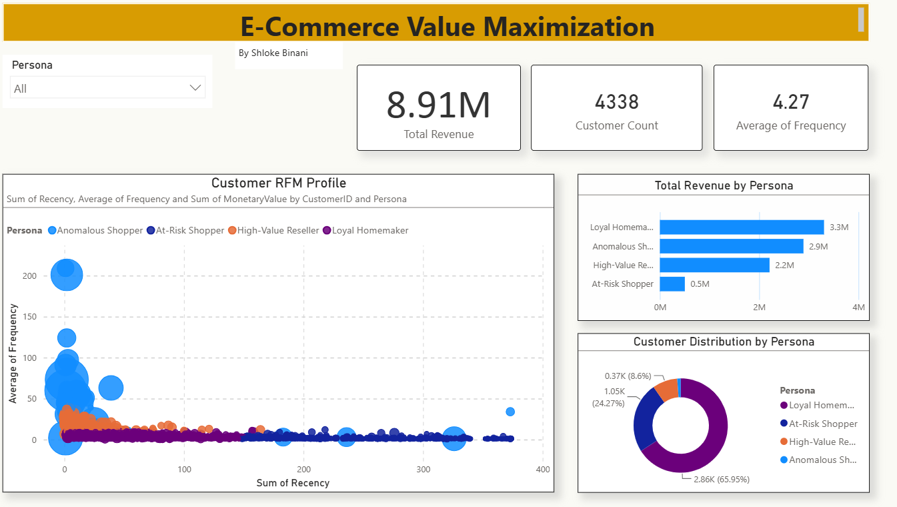

# E-Commerce Customer Segmentation: RFM and Hybrid Clustering

**Author:** Shloke Binani | Academic project



## Overview
This project segments 4,338 e-commerce customers by purchasing behavior. Recency, Frequency and Monetary (RFM) values are calculated with SQL, then DBSCAN isolates outlier customers and K-Means groups the rest into three segments. A Power BI dashboard profiles each segment, and each one gets a proposed retention or growth action.

**Headline results**
- 424 customers (9.8% of the base) generate 57% of revenue.
- 51 outlier customers (1.2%) alone account for 32.5% of revenue.
- 1,053 customers (24%) have been inactive for about 250 days on average and contribute only 5.6% of revenue.

## Data
The public [Online Retail dataset (UCI)](https://archive.ics.uci.edu/dataset/352/online+retail) of transactions from a UK-based online retailer. The raw file `OnlineRetail.csv` is not included in this repository; download it and place it next to the notebook to rerun the first cell. Total revenue across the 4,338 customers with a customer ID is about 8.91M (the dataset's currency is pound sterling). Cancelled orders and rows without a customer ID are excluded.

## Method
1. **SQL (SQLite):** `rfm_query.sql` calculates, per customer, Recency (days since last purchase, measured against one day after the last transaction in the data), Frequency (distinct invoices) and Monetary value (quantity x unit price).
2. **Scaling:** The three metrics are standardized so each carries equal weight.
3. **Hybrid clustering:** DBSCAN (eps = 0.8, min_samples = 15) flags 51 outlier customers. K-Means (k = 3) then clusters the remaining 4,287 customers.
4. **Validation:** Silhouette score is 0.58 for k = 3 on the core customers (k = 2 scores 0.61, k = 4 scores 0.52). k = 3 was chosen because it splits active customers into a regular group and a high-frequency, high-spend group that is easier to act on.

## Segments
| Segment (dashboard label) | Customers | Share of customers | Avg recency (days) | Avg orders | Avg spend | Share of revenue |
| :--- | :--- | :--- | :--- | :--- | :--- | :--- |
| Anomalous Shopper | 51 | 1.2% | 30 | 45.9 | 56,716 | 32.5% |
| High-Value Reseller | 373 | 8.6% | 15 | 14.9 | 5,923 | 24.8% |
| Loyal Homemaker | 2,861 | 66.0% | 47 | 3.1 | 1,156 | 37.1% |
| At-Risk Shopper | 1,053 | 24.3% | 250 | 1.5 | 478 | 5.6% |

The labels describe each segment's RFM pattern. They are interpretations, since the data has no information on who the customers are.

## Proposed actions
These are proposals based on each segment's behavior. None were tested.

| Segment | Proposed action |
| :--- | :--- |
| High-Value Reseller | A business program with tiered bulk pricing, account management and early access to product lines |
| Loyal Homemaker | Bundles and a "Subscribe & Save" option to encourage repeat orders |
| At-Risk Shopper | A win-back campaign with personalized, time-limited incentives |
| Anomalous Shopper | Review the transactions to check for B2B partnership opportunities or data anomalies |

## Dashboard
`cust_segmentation_dashboard.pbix` has one page: KPI cards (total revenue, customer count, average frequency), an RFM scatter plot by segment, revenue by segment, customer distribution by segment, and a segment slicer.

## Limitations
- RFM metrics are heavily skewed and were not log-transformed; a handful of very large customers pull the scaled values.
- The cluster count was chosen for interpretability, not by silhouette score alone.
- Monetary value is historical revenue, not a forecast of customer lifetime value.
- Segment labels are interpretive, and the proposed actions are untested.

## Repository contents
| File | Purpose |
| :--- | :--- |
| `customer_segment_analysis.ipynb` | Loading, SQL, scaling, clustering, validation and profiling |
| `rfm_query.sql` | SQL query that calculates RFM per customer |
| `customer_segments_final.csv` | RFM values and cluster label per customer (input to Power BI) |
| `cust_segmentation_dashboard.pbix` | Power BI dashboard |
| `dashboard_screenshot.png` | Dashboard preview |
| `requirements.txt` | Python dependencies |

## How to run
```
pip install -r requirements.txt
jupyter notebook customer_segment_analysis.ipynb
```
